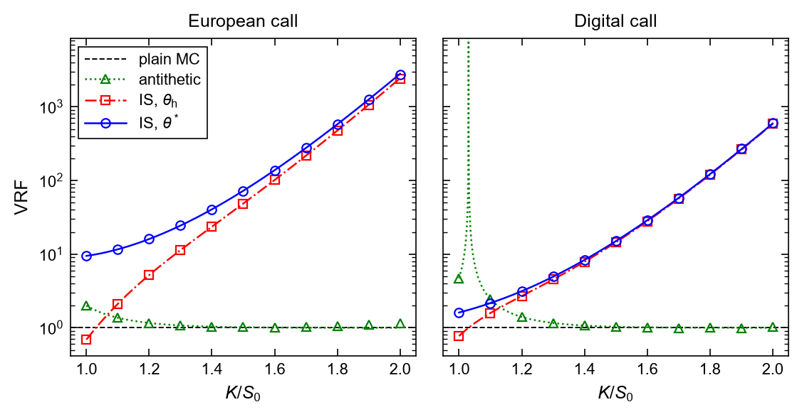
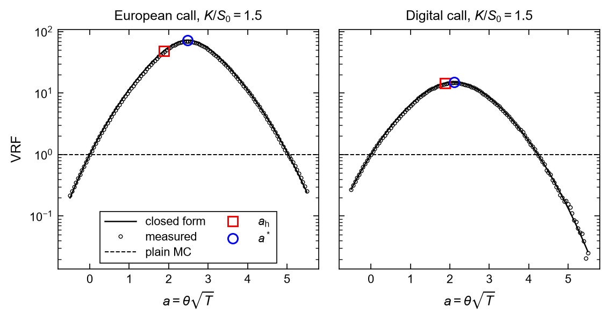
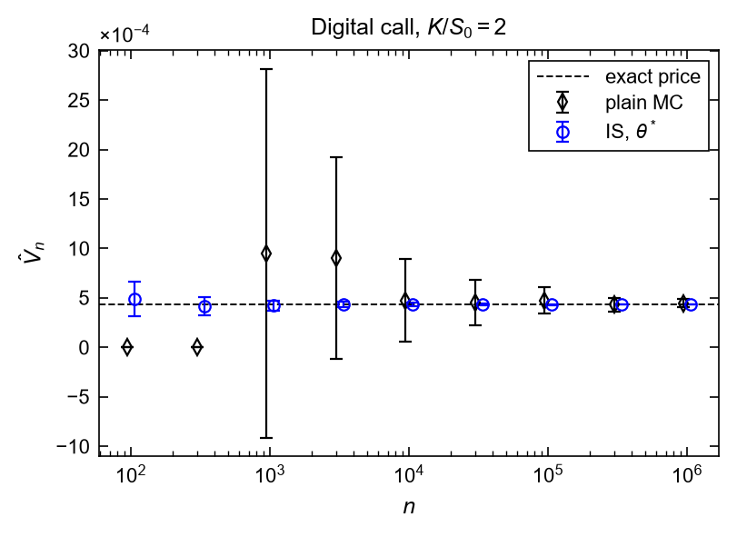
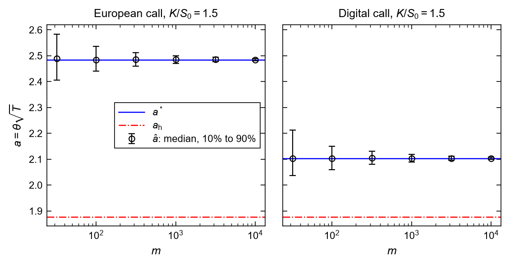

# Importance Sampling via Girsanov's Theorem

**Variance reduction for out-of-the-money options under Black–Scholes**

[](https://github.com/indexxxxbraker/girsanov-importance-sampling/actions/workflows/tests.yml)

> **Read the note:** [`note/note.pdf`](note/note.pdf). Version 1.0.0, November 2026.

Out of the money, plain Monte Carlo wastes almost every sample: at K/S₀ = 2 under Black–Scholes, fewer than one path in 2,000 ends in the money, and every other one contributes a zero to the estimate. This repository samples instead under a measure that adds a constant drift to the Brownian motion, corrects each sample by the Girsanov likelihood ratio, and chooses the drift that minimises the variance. At K/S₀ = 2 the variance then falls by a factor of about 2,800 for the call and 600 for the digital. The optimal drift comes from a closed form, but the method does not depend on it: at K/S₀ = 1.5, a pilot run of 100 samples typically recovers its variance reduction to within half a percent. The [note](note/note.pdf) proves every result about the estimators, and every figure checks the theory against an exact value.

## About this project

My bachelor's thesis in Mathematics, [*From the Risk-Neutral Measure to Girsanov's Theorem in Stochastic Integration: Pricing of Financial Products*](https://github.com/indexxxxbraker/option-pricing-via-martingales), constructs the risk-neutral measure through Girsanov's theorem. A remark in it (Remark 4.16) points out that the same device, computing an expectation under one measure by sampling under an equivalent one and reweighting by the density, is the foundation of importance sampling in Monte Carlo simulation. This repository takes that remark up numerically.

In the thesis, the drift that the change of measure adds to the Brownian motion is the market price of risk, fixed by no-arbitrage, whereas here it is a free parameter, chosen to reduce the variance. The results are compared with plain Monte Carlo and with antithetic variates from my [quant-finance-portfolio](https://github.com/indexxxxbraker/quant-finance-portfolio), whose variance-reduction note leaves importance sampling out of scope.

None of the ingredients is new: importance sampling by a change of drift is a classical technique (P. Glasserman, *Monte Carlo Methods in Financial Engineering*, Springer, 2004, §4.6), and so are the closed-form prices it is tested against. What the note offers is a detailed account of the method, explained step by step, in the simplest setting in which it can be studied completely: the European call and the cash-or-nothing digital under Black–Scholes. Every result about the estimators is proved in the note, and the stochastic calculus, from Girsanov's theorem to the Black–Scholes formulas, is taken from the thesis and cited by number. With a constant drift and a payoff that depends only on S_T, the change of measure reduces to moving the mean of a single Gaussian variable, so every expectation is a one-dimensional Gaussian integral. This is why every quantity of interest has a closed form, from the price to the variance of each estimator, and it is what turns every experiment into a check of the theory against an exact value. What Girsanov's theorem adds to this picture, and what carries over to payoffs that depend on the path (Subsection 6.6 of the note), is that the shift is a change of measure on the whole path space.

I did this work on my own initiative, in the autumn of 2026, as preparation for my Beca de Colaboración (a research grant of the Spanish Ministry of Education for 2026/27) at the Department of Statistics, Operations Research and Mathematics Education of the University of Oviedo. The project of the grant is on changes of measure in stochastic integration and their application to financial engineering, and the constant drift under Black–Scholes is the simplest case of that programme. The grant will extend this work to the general form of Girsanov's theorem (with adapted drifts and the Novikov condition), to the simulation of path-dependent payoffs, and to dynamics beyond Brownian motion, in particular fractional Brownian motion and the Hurst exponent as a measure of persistence in asset prices.

The note and the code cite the thesis by its numbering in the version of 11 November 2026 ([commit `c0ba7d6`](https://github.com/indexxxxbraker/option-pricing-via-martingales/tree/c0ba7d6871aaa43e29615066d5f6c0c1419f90fd)), and the portfolio note in its version of 4 November 2026 ([commit `49bde78`](https://github.com/indexxxxbraker/quant-finance-portfolio/tree/49bde78712b43860a527a96569f397a319fb673f)). The thesis will still be revised before its defence at the University of Oviedo, so later versions may number its results differently.

## Scope

- **Model:** Black–Scholes under the risk-neutral measure, with S₀ = 100, r = 0.05, σ = 0.2 and T = 1.
- **Products:** European call and cash-or-nothing digital call, with K/S₀ from 1.0 to 2.0.
- **Estimators:** plain Monte Carlo; antithetic variates; importance sampling with a constant drift θ, chosen either so that the median of S_T sits at the strike (the heuristic θ_h) or so that the second moment of the estimator is minimised (the optimal θ*, from its closed form, or estimated by a short pilot run as in Figure 4).
- **Comparison:** variance reduction factors at an equal number of payoff evaluations and with common random numbers, and efficiency, that is, variance reduction per unit of computing time.

## Results



*Figure 1.* Variance reduction factor against K/S₀, with n = 10⁶, for the call and the digital: measured values (markers) and closed forms (lines).



*Figure 2.* Variance reduction factor of importance sampling against the drift a = θ√T at K/S₀ = 1.5, with the same draws for every a.



*Figure 3.* The digital at K/S₀ = 2: estimate and 95% confidence interval against n, for plain Monte Carlo and for importance sampling with θ*.



*Figure 4.* Pilot estimate of the optimal drift against the pilot size m at K/S₀ = 1.5, for the call and the digital: median and 10% to 90% band of â = θ̂√T over 500 pilots under θ_h, with a* and a_h marked.

Sections 5 and 6 of the note read each figure against the results that predict it, and Table 1 of its appendix sums up the comparison (also in [`results/tables/e4_summary.csv`](results/tables/e4_summary.csv)). In short:

1. Out of the money the gain is large and it grows fast. With the optimal drift, at K/S₀ = 2, the variance falls by a factor of about 2,800 for the call and 600 for the digital (2,804 and 593 in closed form, 2,735 and 607 as measured in Figure 1). Since a sample of importance sampling costs between 1.30 and 1.74 times as much as one of plain Monte Carlo, the efficiency there is still 1,610 and 342 (Table 1 of the note, whose own draws give factors of 2,520 and 593).
2. The heuristic drift is not a safe default. Near the money it is worse than doing nothing (0.69 for the call and 0.77 for the digital at K/S₀ = 1), because there it pushes S_T down, and out of the money it stays close to the optimum for the digital but not for the call (48.5 against 72.4 at K/S₀ = 1.5).
3. Antithetic variates and importance sampling split the range between them: antithetic variates help near the money (2.0 for the call and 4.7 for the digital at K/S₀ = 1), precisely where the heuristic fails, and give nothing out of the money, precisely where importance sampling gains most.
4. Deep out of the money the confidence interval of plain Monte Carlo fails. At K/S₀ = 2 no path ends in the money at n = 100 and n = 316, and the interval collapses to {0}, with the price outside, whereas under the optimal drift 56% of the paths end in the money and the interval contains the price at every n of the run. Section 6 of the note explains why this failure and the degenerate weights of an excessive drift are one and the same.
5. The optimal drift does not have to be known in advance. At K/S₀ = 1.5, a pilot run of 100 samples under the heuristic drift estimates it well enough that eight pilots out of ten keep at least 99.6% of the variance reduction of θ*, whereas the heuristic alone keeps 67% of it for the call and 96% for the digital. An error in the drift costs little because θ* is a minimum, so the variance grows only to second order in that error.

## Reproducing the results

```bash
python -m pip install -e ".[dev]"
python -m pytest
python -m experiments.make_figures
```

The script runs in less than a minute on a laptop. It writes every figure to `results/figures/`, as a PDF for the note, a PNG for this README and a CSV with the numbers behind it, and the summary table to `results/tables/`, as a CSV and as a LaTeX fragment. All the parameters, and the master seed from which every experiment draws its own stream, are in `experiments/config.py`, so on the same machine and with the same versions of NumPy and SciPy every number is reproducible bit for bit, and elsewhere up to its last digits. The exception is the times of the table, and with them its relative costs and efficiencies, which are measured on the machine that runs the script and change slightly from one run to the next. The committed table, the one quoted in the note, was measured on a laptop with an Intel Core i5-1135G7 processor under Windows. The note compiles with `pdflatex` from `note/`, with the `cm-super` fonts installed, and it reads the figures and the table from `results/`.

The tests check the closed-form prices against independent references, every estimator against them within four standard errors, the closed-form second moments against samples, the coverage of the confidence intervals, and that a pilot run recovers the optimal drift. They run on GitHub Actions, under Python 3.10 and 3.14, on every push.

## Repository layout

```
girsanov-importance-sampling/
├── src/girsanov_is/     Python package: closed-form prices, estimators and the choice of θ
├── tests/               pytest suite
├── experiments/         config.py (parameters and seed) and make_figures.py (the single script)
├── results/             figures/ (PDF, PNG and CSV) and tables/ (CSV and LaTeX)
├── note/                the note, in LaTeX and in PDF: theory, results and limitations
└── .github/workflows/   continuous integration
```

## How this project was made

The idea and the scope of the project are mine. For each section of the note, Claude (Anthropic) prepared a theory note, which I studied, and I then fixed the content of the section, either in a handwritten outline or by commenting in writing on an outline proposed by Claude. Parts of the text I wrote myself, and Claude checked their English and that the whole note followed a clear thread and was well structured, while the rest Claude wrote up in LaTeX from my outlines. I revised and approved every section. The code, tests included, was written by Claude from specifications we agreed on, and I read every change and ran the tests on it before committing it. Claude also proposed part of the experimental design (what is measured, and with which parameters and tolerances), which we discussed and I approved, and the note gives the reasoning behind each choice.

## License

The code is released under the [MIT License](LICENSE). The note in `note/` is licensed under [CC BY 4.0](note/LICENSE).

## Author

**Roberto Cepeda Rocandio**, Mathematics & Physics undergraduate, University of Oviedo.

LinkedIn: [linkedin.com/in/robertocepedarocandio](https://www.linkedin.com/in/robertocepedarocandio) · Email: robertocepedarocan@gmail.com
